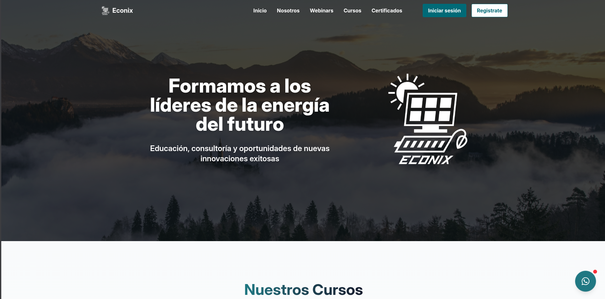
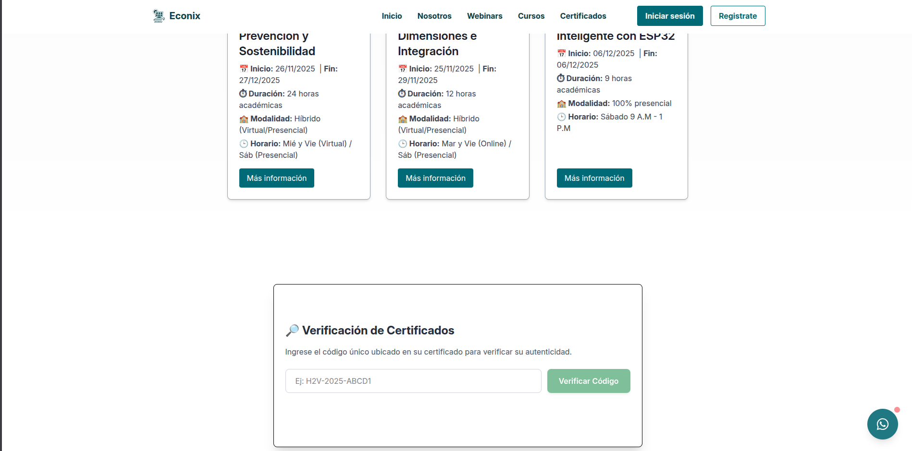
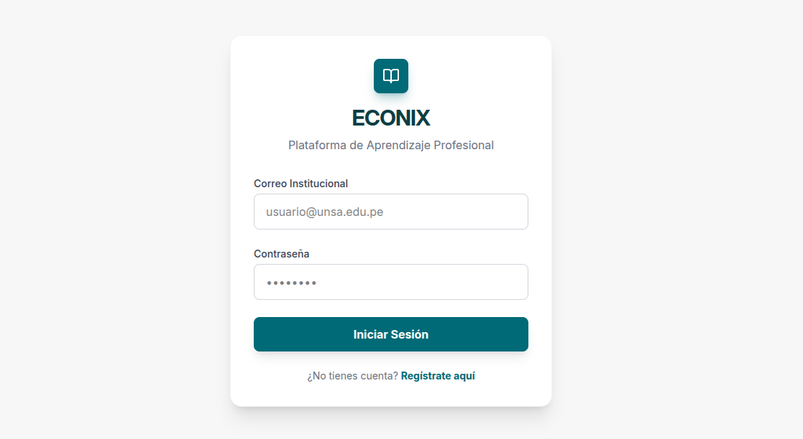
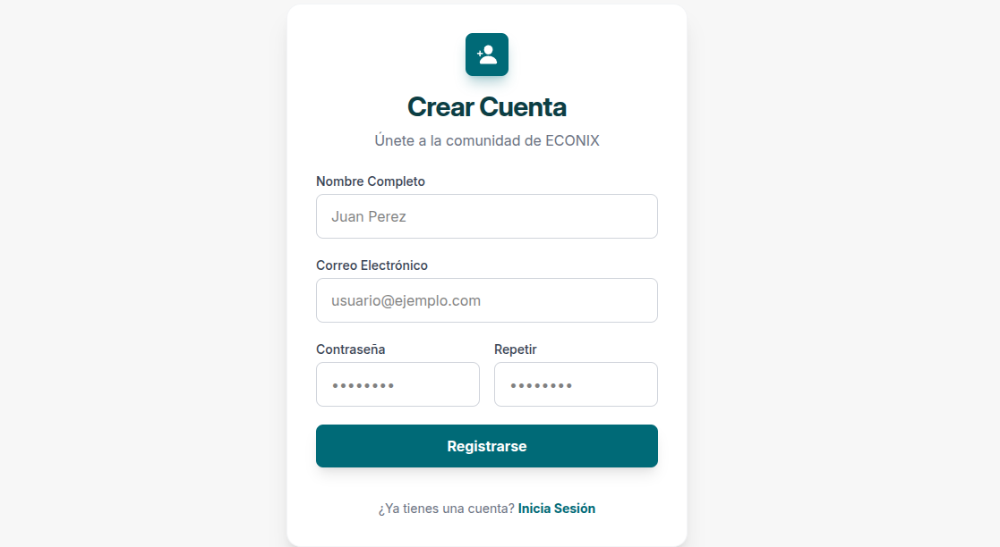
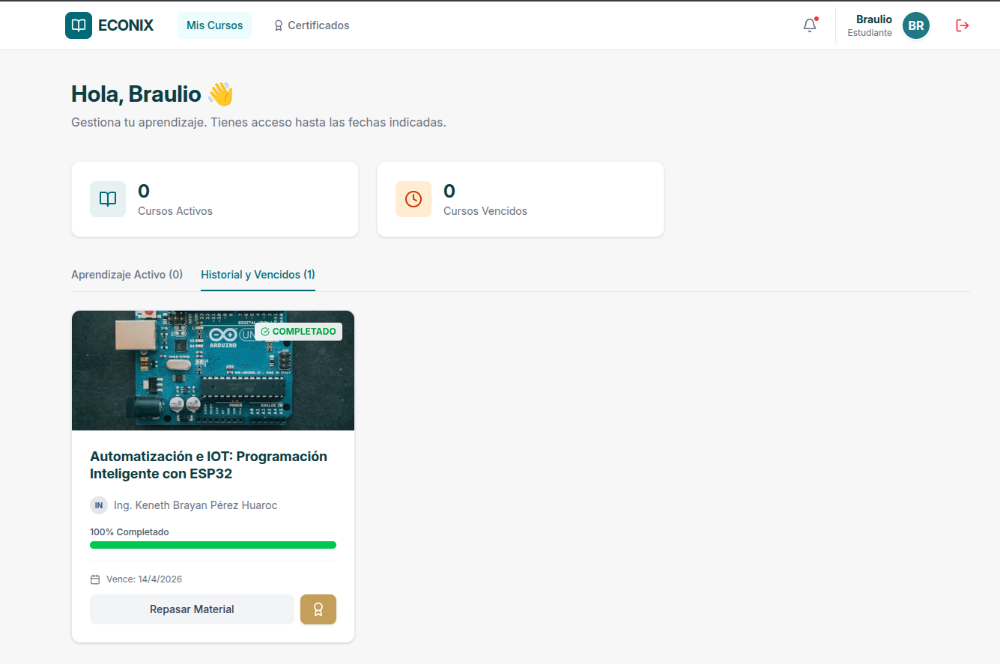
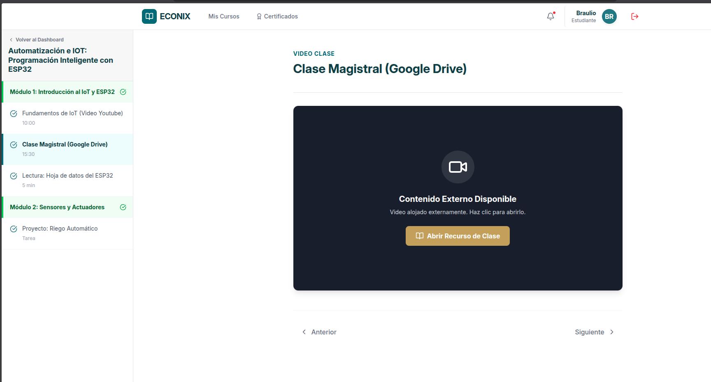
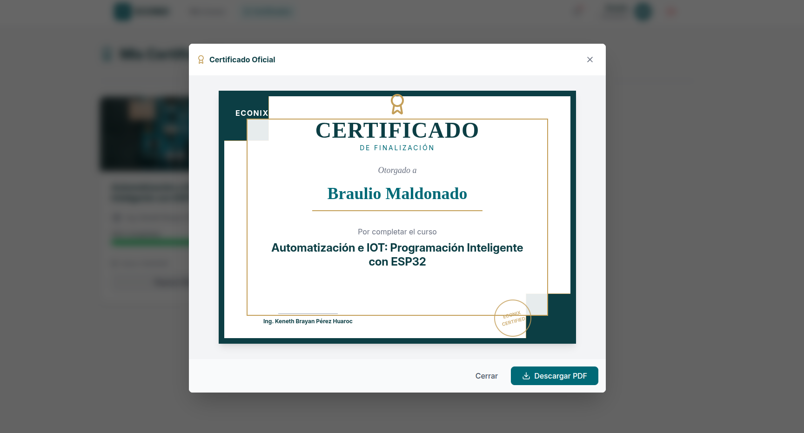

# Informe Técnico: Módulo de Gestión de Aprendizaje (LMS)

## 1. Descripción General del Proyecto

Este documento detalla la implementación de la interfaz de usuario para el sistema de gestión de aprendizaje (LMS). El objetivo del módulo es proporcionar una plataforma intuitiva para la autenticación de usuarios, gestión de cursos, visualización de contenido educativo y emisión de certificados.

## 2. Arquitectura de Vistas e Interfaz de Usuario

### 2.1. Página de Inicio (Landing Page)

La puerta de entrada al ecosistema educativo presenta una interfaz moderna y responsiva, diseñada para atraer a nuevos estudiantes y facilitar la navegación hacia los cursos disponibles.

### 2.2. Módulo de Autenticación

Se ha implementado un sistema seguro de control de acceso que permite tanto el ingreso de usuarios registrados como el alta de nuevos estudiantes.

- **Inicio de Sesión (Login):** Interfaz para validación de credenciales.

- **Registro de Usuarios (Sign Up):** Formulario para la creación de nuevos perfiles de estudiante.

> **Credenciales de Acceso para Pruebas (Entorno de Desarrollo):**
>
> - **Usuario:** `comercial.phinix@gmail.com`
> - **Contraseña:** `12345`

### 2.3. Panel del Estudiante (Dashboard)

Tras una autenticación exitosa, el usuario es redirigido al Dashboard principal. Esta vista centraliza la experiencia de aprendizaje, clasificando los cursos en dos categorías:

1. **Cursos Activos:** Formación en curso y pendiente de finalización.
2. **Historial Académico:** Cursos vencidos o completados satisfactoriamente.

### 2.4. Reproductor de Clases y Contenido

La interfaz de lecciones ("Course Player") permite el consumo de material educativo multimedia. Incluye navegación entre módulos, visualización de video/texto y seguimiento del progreso en tiempo real.

### 2.5. Sistema de Certificación

Al completar satisfactoriamente todos los módulos de un curso, el sistema genera automáticamente un certificado de finalización. Este documento es visualizable en pantalla y descargable en formato PDF para el portafolio del estudiante.

---

## 3. Estado del Proyecto y Hitos Pendientes (Roadmap)

Actualmente, el módulo **Vista Estudiante** se encuentra finalizado y funcional. Las próximas fases de desarrollo se centrarán en los roles administrativos y de gestión académica.

---

## 4. Servidor del LMS (Backend)

El código fuente, la base de datos y la configuración del servidor se encuentran alojados en la carpeta [servidor_lms](./servidor_lms).

---

### Próximos Entregables (To-Do List)

#### Fase 1: Panel de Administración (Admin View)

- [ ] Implementación de gestión de usuarios (CRUD): Creación, edición y eliminación de cuentas.
- [ ] Asignación de roles y permisos: Capacidad para designar cuentas de "Profesor" y "Administrador".

#### Fase 2: Panel del Instructor (Teacher View)

- [ ] Herramientas de gestión de contenido: Interfaz para crear cursos y estructurar módulos.
- [ ] Carga de recursos: Funcionalidad para subir videos, textos y asignaciones (Lessons).

#### Fase 3: Integración de Matrícula Automatizada

- [ ] Sincronización Landing-LMS: Implementación de lógica para que la compra/inscripción en la _Landing Page_ habilite automáticamente el acceso al curso en el Dashboard del LMS, eliminando la necesidad de matriculación manual y permitiendo el consumo asíncrono (clases grabadas) inmediato.
